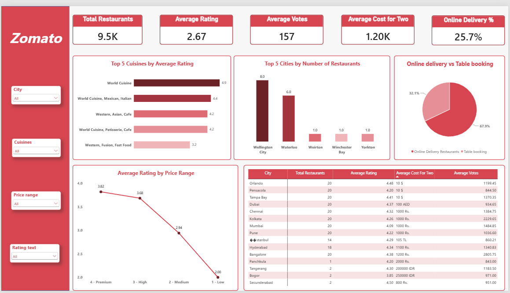

# Zomato-Analysis-Dashboard

#📌 Project Overview
The Zomato Restaurant Analysis Dashboard is an interactive Power BI project designed to analyze restaurant performance, customer ratings, pricing, cuisines, locations, and online delivery trends. The dashboard converts restaurant data into clear and actionable insights using KPI cards, charts, slicers, and a detailed city-level table.

#🎯 Project Objective
The objective of this project is to identify:

1. Restaurant distribution across cities
2. Top-rated cuisines
3. Customer rating and voting patterns
4. Pricing trends across different price ranges
5. Online delivery and table-booking availability
6. City-level restaurant performance

#📊 Dashboard Walkthrough
#1. KPI Cards
The top section provides a quick overview of the restaurant dataset through five key indicators: 9.5K total restaurants, 2.67 average rating, 157 average votes, 1.20K average cost for two, and 25.7% online delivery. These KPIs give users an immediate summary before exploring deeper analysis.

#2. Top 5 Cuisines by Average Rating
The horizontal bar chart compares the top five cuisine combinations according to average rating. It helps identify which cuisine groups receive stronger customer ratings and enables quick comparison between the highest-performing cuisine categories.

#3. Top 5 Cities by Number of Restaurants
The city chart highlights locations with the highest restaurant presence in the current dashboard view. Wellington City and Waterloo appear prominently, followed by locations including Weirton, Winchester Bay, and Yorkton, helping users understand geographic restaurant distribution.

#4. Online Delivery vs Table Booking
The pie chart compares restaurants represented by online delivery and table booking categories, showing a visual split of approximately 67.9% and 32.1% in the displayed analysis. This helps users understand the relative availability of these service options.

#5. Average Rating by Price Range
The line chart examines how average restaurant ratings vary across price ranges. In the displayed dashboard, the average rating moves from approximately 3.82 for Premium to 3.68 for High, 2.94 for Medium, and 2.00 for Low, highlighting a visible relationship between price category and average rating in the analyzed data.

#6.City-Level Restaurant Analysis
The detailed table provides a granular comparison of cities using Total Restaurants, Average Rating, Average Cost for Two, and Average Votes. This visual complements the charts by allowing users to inspect city-specific values and compare multiple performance indicators together.

#7. Interactive Filters
The left-side slicer panel contains filters for City, Cuisines, Price Range, and Rating Text. These filters make the dashboard interactive by allowing users to narrow the analysis and dynamically explore restaurant performance for selected categories.

#💡 Key Insights

1. The dataset contains approximately 9.5K restaurants.
2. Overall average rating is 2.67.
3. Restaurants receive approximately 157 votes on average.
4. Online delivery is available for 25.7% based on the KPI calculation displayed.
5. Higher price categories show stronger average ratings in the displayed price-range analysis.
6. Restaurant presence and performance vary considerably between cities.
7. Interactive filters enable deeper analysis by cuisine, location, price range, and rating category.

#🚀 Conclusion

This project demonstrates my ability to use Power BI for data cleaning, analysis, KPI creation, DAX calculations, interactive visualization, and dashboard development. The Zomato Restaurant Analysis Dashboard transforms restaurant data into an easy-to-understand analytical report that supports exploration of customer preferences, restaurant locations, pricing, ratings, and service availability.

# Screenshot

 
